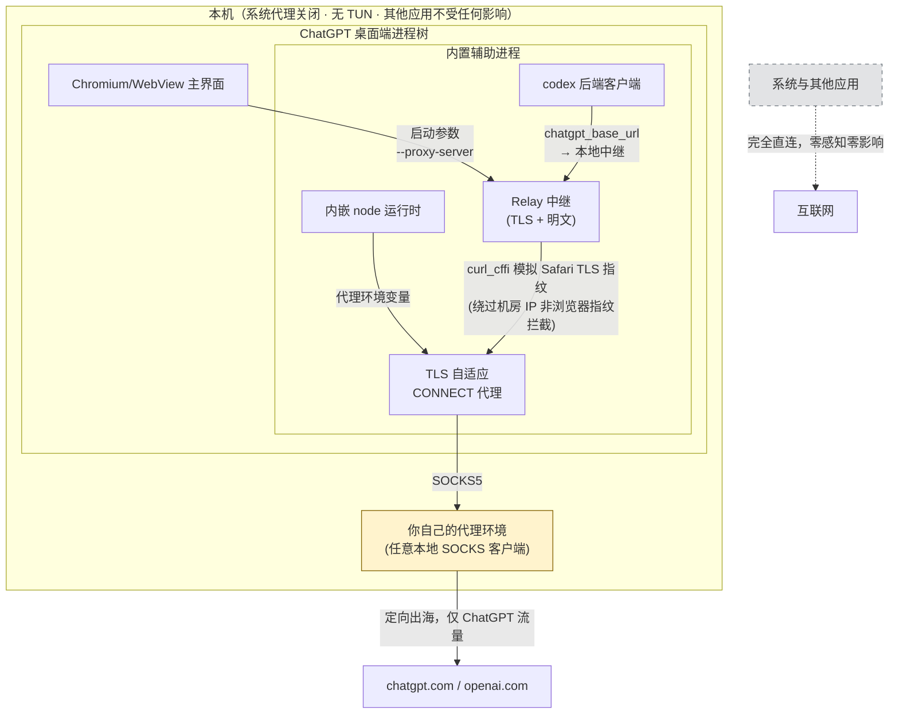

# MeiCodexHelper

**ChatGPT 桌面端（Codex 内核）的跨平台网络访问增强工具。** 支持 macOS 与 Windows。

> **重要定位**：MeiCodexHelper 本身**不提供任何代理服务**——它不是机场、不是 VPN、也不内置任何节点。它专注做一件事：让 ChatGPT 桌面端在你的**已有代理环境**下正确、稳定、定向地工作，且**完全不干扰系统与其他应用的网络**。

## 核心策略：定向代理，系统零干扰

ChatGPT 桌面端没有应用内代理设置：macOS 上只跟随系统代理或 TUN，Windows 上则完全不认代理——前者影响全局，后者无处下手。MeiCodexHelper 的答案是**在应用进程层定向接管**：



**三步定向接管，各解决一个真实问题：**

| 环节 | 解决的问题 |
|---|---|
| 启动参数 + 环境变量注入 | Chromium 主界面与内嵌 node 进程各自直连，且桌面端**没有**代理设置入口 |
| Relay 中继（Safari 指纹） | 数据中心出口 IP + 非浏览器 TLS 指纹会被 Cloudflare 直接 403；Chrome 指纹模拟也会被识破，Safari 指纹可通过；同时完成路径重写（`/api/*`→`/backend-api/*`）、Cookie 域改写、WebSocket 隧道 |
| TLS 自适应 CONNECT | codex 的代理机制会强制把 `HTTPS_PROXY` 改写为 `https://` scheme，普通代理无法服务 |

**稳定性设计**：内核内置熔断器（同接口连续 401/403 触发冷却，防止客户端重试风暴触发风控）+ 跨平台看门狗（异常自动拉起）。

**边界说明**：代理节点侧的问题（IP 被标记、账号策略要求 MFA 等）不在本工具管辖范围，但诊断功能会明确指出是哪一层的问题。

## 分层架构

```
core/       共享内核（跨平台 Python, 双端完全一致）
├── relay.py        指纹中继（TLS/明文/WS 隧道/熔断器）
├── tlsproxy.py     TLS 自适应 CONNECT 代理
├── engine_core.py  状态/启停/日志（平台无关）
├── watchdog.py     跨平台看门狗
├── certs.py        证书生成（纯 Python）
└── paths.py        平台路径抽象（APPDATA ↔ Application Support）

mac/                macOS 平台层
├── MeiCodexHelper/App.swift   SwiftUI 菜单栏+控制台+设置
├── engine.sh                  launchd/钥匙串/open --env 注入
└── netwatch.sh + build.sh

windows/            Windows 平台层 (Preview)
├── gui/app.py                 tkinter 托盘+控制台+设置（同构界面）
├── engine.ps1                 证书存储/启动项/Start-Process 环境注入
└── build.ps1                  PyInstaller 打包（GUI+3个内核服务 exe, 免 Python 环境）
```

## 使用

### macOS
1. 准备：一个可用的本地代理环境（任意提供 `socks5://127.0.0.1:端口` 的客户端均可）
2. 首次：菜单栏盾牌图标 → 安装/修复（幂等；会配置 `~/.codex` 并可能弹出钥匙串授权）
3. 日常：菜单 → **启动 ChatGPT（增强）**（冷启动才注入参数）
4. 观察与排障：菜单 → 打开控制台

### Windows (Preview)
1. 从 Release 下载 `MeiCodexHelper-<版本>-windows.zip` 并解压
2. 右键 `engine.ps1` 所在目录 → 在终端打开，执行：
   ```powershell
   powershell -ExecutionPolicy Bypass -File engine.ps1 install
   ```
3. 运行 `MeiCodexHelper.exe`（托盘 + 控制台/设置双 Tab），点「启动 ChatGPT (增强)」
4. 卸载：`engine.ps1 uninstall --yes`

> Windows 版说明：CA 证书装入当前用户根存储（无需管理员）；后台服务由启动项的看门狗托管；远程控制支持为实验性。

## 可配置项

设置界面可视化编辑，多方案存于 `profiles/`，启用者写入 `config.json`：

| 变量 | 默认 | 说明 |
|---|---|---|
| proxy_socks_host / proxy_socks_port | 127.0.0.1 / 7890 | **上游代理环境**的 SOCKS 地址 |
| relay_tls_port / relay_plain_port | 8943 / 8945 | 中继 TLS/明文端口 |
| connect_proxy_port | 8944 | TLS 自适应 CONNECT 代理端口 |
| impersonate | safari17_0 | TLS 指纹（chrome 系会被 CF 识别，勿轻易改） |
| upstream_host | chatgpt.com | 上游域 |
| remote_control | true | 远程控制支持 |
| watch_interval_sec | 60 | 看门狗周期 |

## 构建

```bash
./build.sh                                    # macOS (需 Xcode CLT)
powershell -File windows/build.ps1            # Windows (需 Python 3.11+)
```

或推送 `v*` 标签，GitHub Actions 双平台矩阵构建并聚合发布（macOS 签名仅需 2 个可选 Secrets：`MACOS_CERT_P12_BASE64` / `MACOS_CERT_P12_PASSWORD`，未配置时 ad-hoc）。

## 排障速查

| 症状 | 位置 | 常见原因 |
|---|---|---|
| 面板/用量加载失败 | 控制台日志 `-> 200 auth` | 信任失效/curl_cffi 丢失 → 重跑安装 |
| 启动 ChatGPT 后无法联网 | 是否经「启动 ChatGPT」冷启动 | 参数仅冷启动生效 |
| 诊断显示上游代理停止 | 确认代理客户端运行、端口一致 | 上游环境未启动或端口不匹配 |
| Unusual activity 风控 | 熔断日志 | 客户端重试风暴（熔断器会自动拦截）→ 冷却后重新登录 |
| 切换账号后远程控制异常 | 控制台重启 Daemon | daemon 内存残留旧账号 token |
