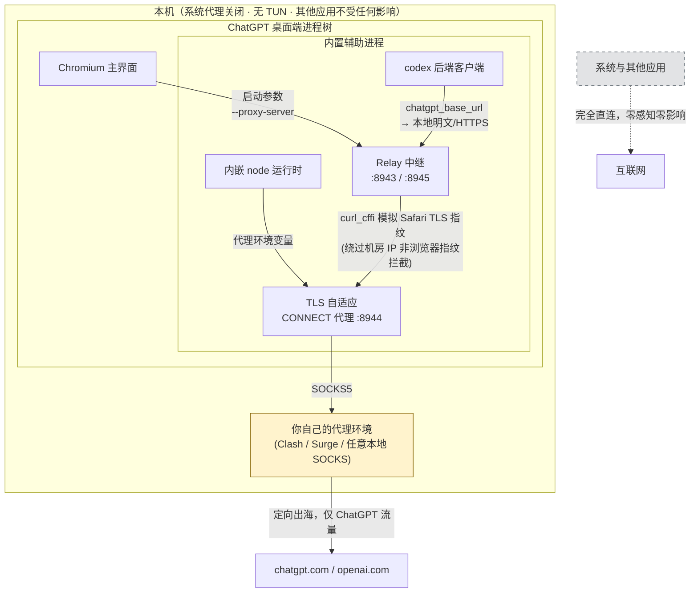

# MeiCodexHelper

**ChatGPT macOS 桌面端（Codex 内核）的网络访问增强工具。**

> **重要定位**：MeiCodexHelper 本身**不提供任何代理服务**——它不是机场、不是 VPN、也不内置任何节点。它专注做一件事：让 ChatGPT 桌面端在你的**已有代理环境**下正确、稳定、定向地工作，且**完全不干扰系统与其他应用的网络**。

## 核心策略：定向代理，系统零干扰

ChatGPT 桌面端没有应用内代理设置：它只跟随系统代理或 TUN——前者影响全局，后者要改网卡。MeiCodexHelper 的答案是**在应用进程层定向接管**：



**三步定向接管，各解决一个真实问题：**

| 环节 | 解决的问题 |
|---|---|
| 启动参数 + 环境变量注入 | Chromium 主界面与内嵌 node 进程各自直连，且桌面端**没有**代理设置入口 |
| Relay 中继（Safari 指纹） | 数据中心出口 IP + 非浏览器 TLS 指纹会被 Cloudflare 直接 403；Chrome 指纹模拟也会被识破，Safari 指纹可通过；同时完成路径重写（`/api/*`→`/backend-api/*`）、Cookie 域改写、WebSocket 隧道 |
| TLS 自适应 CONNECT | codex 的代理机制会强制把 `HTTPS_PROXY` 改写为 `https://` scheme，普通代理无法服务 |

**边界说明**：任何代理节点侧的问题（IP 被 Cloudflare 标记、节点协议过旧、账号策略要求 MFA 等）不在本工具管辖范围内，但诊断功能会明确指出是哪一层的问题。

## 功能

- **控制台**：六项服务状态卡片（可单项重启）、启动/重启/停止、诊断报告、双通道实时日志
- **设置**：多配置方案（新建/复制/删除/一键切换启用），全部参数可视化编辑
- **菜单栏**：整体状态一眼可见，快捷操作直达
- **看门狗**：周期体检，异常自动拉活

## 使用

1. 准备：一个可用的本地代理环境（任意提供 `socks5://127.0.0.1:端口` 的客户端均可，Clash Verge / Surge / sing-box 等）
2. 首次：菜单栏盾牌图标 → 安装/修复（幂等，可随时重跑；会配置 `~/.codex` 并可能弹出钥匙串授权）
3. 日常：菜单 → **启动 ChatGPT（增强）**（冷启动才注入参数）
4. 观察与排障：菜单 → 打开控制台

## 可配置项

设置界面可视化编辑，多方案存于 `profiles/`，启用者写入 `config.json`：

| 变量 | 默认 | 说明 |
|---|---|---|
| proxy_socks_host / proxy_socks_port | 127.0.0.1 / 7890 | **上游代理环境**的 SOCKS 地址（兼容旧键 `clash_socks_*`） |
| relay_tls_port / relay_plain_port | 8943 / 8945 | 中继 TLS/明文端口 |
| connect_proxy_port | 8944 | TLS 自适应 CONNECT 代理端口 |
| impersonate | safari17_0 | TLS 指纹（chrome 系会被 CF 识别，勿轻易改） |
| upstream_host | chatgpt.com | 上游域 |
| remote_control | true | 远程控制(daemon 明文)支持 |
| watch_interval_sec | 60 | 看门狗周期 |

## 文件位置

- 服务/证书/日志/配置：`~/Library/Application Support/MeiCodexHelper/`
- LaunchAgents：`com.income.chatgpt-relay` / `com.income.codex-tlsproxy` / `com.income.chatgpt-netwatch`
- codex 接入点：`~/.codex/config.toml`（`chatgpt_base_url`）与 `~/.codex/.env`（安装自动备份 `.bak-cnhelper`）

## 构建

```bash
./build.sh   # 需 Xcode Command Line Tools (swiftc)
```

或直接推送 `v*` 标签，GitHub Actions 自动构建签名并发布 Release（签名/公证参数见 workflow 内注释，通过仓库 Secrets 配置，全部可选——不配置时使用 ad-hoc 签名）。

## 排障速查

| 症状 | 位置 | 常见原因 |
|---|---|---|
| 面板/用量加载失败 | 控制台日志 `-> 200 auth` | rustls 信任失效/curl_cffi 丢失 → 重跑安装 |
| 启动 ChatGPT 后无法联网 | 是否经「启动 ChatGPT」冷启动 | 参数仅冷启动生效 |
| 诊断显示上游代理停止 | 确认代理客户端运行、端口一致 | 上游环境未启动或端口不匹配 |
| 远程控制开启失败 | 诊断输出 mfa_requirement | 账号策略要求 MFA（服务端 403 会明说） |
| 切换账号后远程控制异常 | 控制台重启 Daemon | daemon 内存残留旧账号 token |
